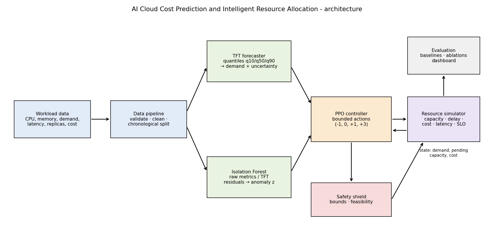

# AI Cloud Cost Prediction and Intelligent Resource Allocation

Research prototype: **TFT** workload forecasting (quantiles) + **Isolation Forest** anomaly scores + **PPO** replica
controller inside a **resource simulator** with provisioning delays, plus fixed / reactive / predictive baselines,
ablations, tests and a Streamlit dashboard. Research extension: *uncertainty-aware, delay-aware predictive
autoscaling* (TFT uncertainty and pending-capacity state in the PPO state).

> **Read first.** All numbers below come from a **synthetic workload** and a **simulator** (cost is simulated USD,
> latency is a documented approximation). They are not cloud invoices and do not show anything about a real
> Kubernetes HPA. Novelty versus the literature has **not** been validated (see `docs/methodology.md` section 9).



## 1. Objectives and hypotheses
H1 TFT forecasts beat persistence / moving-average / seasonal-naive. H2 forecast-based scaling beats tuned reactive
scaling. H3 TFT uncertainty helps PPO. H4 pending-capacity state helps under provisioning delay. H5 an anomaly
score helps PPO. Each is tested in `docs/experiments.md`; results decide, not the hypotheses.

## 2. Setup
```bash
python -m venv .venv
.\.venv\Scripts\Activate.ps1          # Windows PowerShell   (Linux/macOS: source .venv/bin/activate)
python -m pip install --upgrade pip
pip install -r requirements.txt       # pinned to the tested versions (Python 3.12)
```
Dataset: by default a labelled synthetic trace is generated (`configs/data.yaml`, 5 services x 40 days, 5-minute
steps). For a real trace put it in `data/raw/`, set `dataset.source: csv`, `raw_file`, `column_map`. Schema:
`timestamp, cpu_utilization, memory_utilization, request_rate, latency_ms, replica_count, pending_replicas,
resource_cost, anomaly_label` (+ `service_id`); only `timestamp` and `request_rate` are required; missing
columns are reported and `resource_cost` is derived from the explicit price model.

## 3. Run
```bash
python scripts/prepare_data.py --regenerate     # validate, clean, split 70/15/15, features
python scripts/train_all.py --profile quick     # TFT, Isolation Forest, PPO variants x seeds
python -m src.forecasting.evaluate              # Experiment 1
python -m src.evaluation.run_experiment --policy reactive
python -m src.evaluation.run_experiment --policy ppo --variant ppo_full --seed 0
python scripts/run_all_experiments.py --profile quick   # Experiments 1-5, tables, figures, docs/final_report.md
pytest -q
streamlit run src/dashboard/app.py
```

## 4. Results actually obtained (profile `quick`: 3 PPO seeds, 150k steps; test period)
**Forecasting (Exp. 1)** - TFT MAE 21.8 / RMSE 64.9 req/s vs persistence 31.3 / 83.4 (MAE 30% lower), moving average
43.4 / 80.9, seasonal-naive 41.7 / 97.4. 10-90% interval coverage 73.6% (nominal 80%): intervals are somewhat too narrow.

**Policies (Exp. 2-3)**, simulated cost per trace, SLO = modelled latency > 300 ms or dropped requests:

| policy | cost | vs reactive | SLO-violating intervals | P95 ms | scaling events/day |
|---|---|---|---|---|---|
| fixed (train p95) | 57.17 | -38.2% | 0.70% | 126 | 0 |
| fixed (peak) | 171.50 | -314.7% | 0.00% | 51 | 0 |
| reactive (tuned) | 41.35 | 0 | 1.11% | 193 | 18.1 |
| predictive (TFT median) | 36.86 | +10.9% | 1.18% | 225 | 18.2 |
| predictive (TFT q90) | 37.67 | +8.9% | 1.08% | 212 | 15.7 |
| PPO point forecast + pending | 46.43 ± 1.41 | -12.3% | 1.88% ± 0.63 | 259 | 139.5 |
| PPO uncertainty + pending (proposed) | 44.02 ± 1.03 | -6.5% | 2.18% ± 0.17 | 309 | 155.9 |

**Honest reading.** Predictive scaling was cheaper than tuned reactive scaling (about 9-11%) with similar SLO violations.
In this short-training run **PPO did not beat the tuned rule-based baselines** (higher cost, more SLO violations, and
roughly 8x more scaling events because actions are sampled from the policy). Between PPO variants most differences are
within seed-to-seed variation; the exceptions are that uncertainty + pending (`ppo_full`) cost slightly less than
point forecast + pending, and that pending state lowered SLO violations versus none in the point-forecast pair
(`ppo_point` vs `ppo_base`). No claim about the research extension is supported yet; use the `full` profile
(5 seeds, 300k steps), stronger tuning and real traces before drawing conclusions.

**Delay sensitivity (Exp. 4)** - SLO-violating intervals at test-time delay 0/1/3/6: see `docs/final_report.md` and
`results/figures/delay_sensitivity.png`. **Anomaly (Exp. 5)** - Isolation Forest on raw metrics F1 0.51 (AUROC 0.97),
on TFT residuals F1 0.57 (AUROC 0.74) with synthetic labels; adding either score to PPO changed results within seed variability.

Full tables: `results/metrics/`, figures: `results/figures/`, auto-generated report: `docs/final_report.md`.
Tests: `results/metrics/test_results.txt` (52 passed).

## 5. Repository map and documents
`docs/architecture.md`, `docs/methodology.md`, `docs/experiments.md`, `docs/limitations.md`, `docs/final_report.md`.
Large artefacts (`data/raw`, `data/processed`, model checkpoints, step logs) are git-ignored; regenerate with the commands above.

## 6. Limitations, safety, reproducibility
See `docs/limitations.md`. Every action passes a safety shield (bounds, scale-down feasibility). Every run stores its
config snapshot, seed and library versions in `results/metrics/runs/*.json`. `deploy/` holds an **untested**
observation-only Kubernetes scaffold; applying changes is deliberately not implemented.
