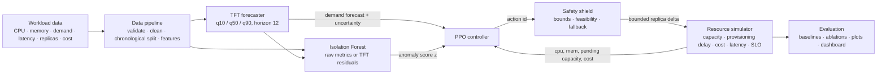

# Architecture

## Components and files

| Layer | Files | Responsibility |
|---|---|---|
| Data | `src/data/*` | load, validate, clean, resample, split chronologically, engineer features, build leakage-safe windows |
| Forecasting | `src/forecasting/*` | TFT training, quantile inference, comparison with persistence / moving-average / seasonal-naive |
| Anomaly | `src/anomaly/*` | two Isolation Forests (raw metrics, forecast residuals), scoring, detection metrics |
| Environment | `src/environment/*` | synthetic workload generator, simulator, cost model + reward, Gymnasium wrapper |
| Controller | `src/controller/*` | PPO training, policy wrapper, safety shield |
| Baselines | `src/baselines/*` | fixed, reactive (HPA-like), predictive (median / upper-quantile) |
| Evaluation | `src/evaluation/*` | metrics, repeatable runs, ablations, comparison tables / figures, report generation |
| Dashboard | `src/dashboard/app.py` | Streamlit view of the pipeline outputs |

## Data flow in one decision step

1. Time `t`: the environment exposes CPU/memory of the interval just served, current demand, ready and
   pending replicas (by remaining delay), the TFT forecast issued at `t` (median and 10-90 % spread at
   horizons 1, 3, 6, 12) and optionally an anomaly score computed from data up to `t`.
2. The policy picks one of four discrete actions `{-1, 0, +1, +3}` replicas.
3. The safety shield validates and clips the action (bounds, scale-down feasibility, optional emergency fallback).
4. The simulator registers the request (new replicas are *pending* and billed), serves interval `t+1`
   with the replicas that are actually ready, and computes cost, latency, SLO violation and reward.

## Artefact locations

| Artefact | Path |
|---|---|
| Raw / processed data, forecasts, anomaly scores | `data/raw`, `data/processed` |
| TFT checkpoint + dataset parameters | `models/forecasting/` |
| Isolation Forests | `models/anomaly/` |
| PPO checkpoints, configs, selection history | `models/controller/<variant>/seed<k>/` |
| Run records (config snapshot, seed, metrics) | `results/metrics/runs/*.json` |
| Step logs, PPO episode-reward logs | `results/logs/` |
| Tables, figures | `results/metrics/`, `results/figures/` |
